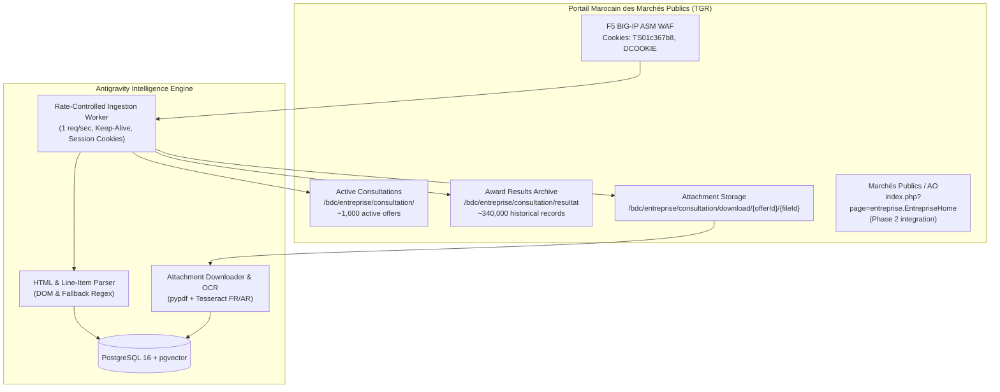
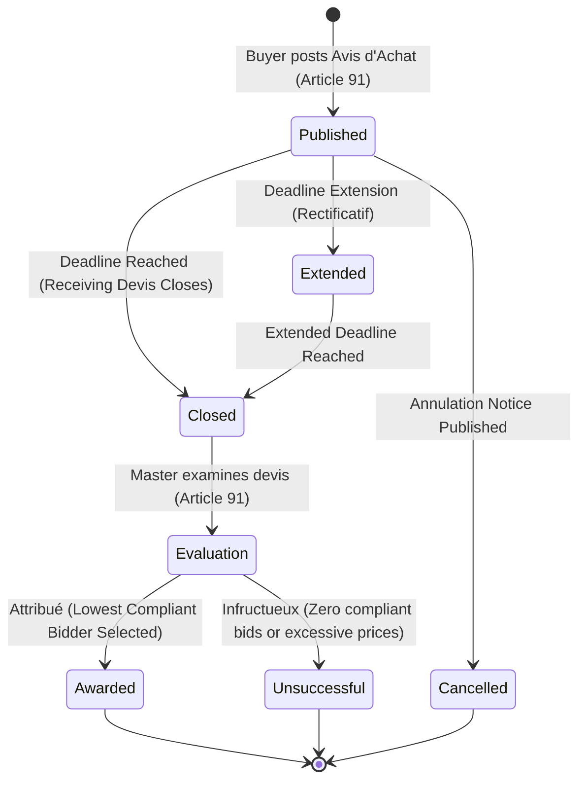
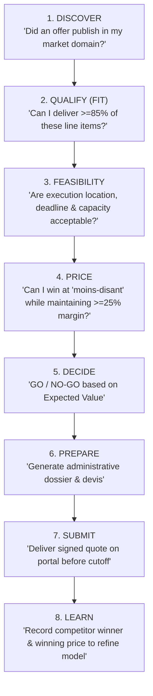
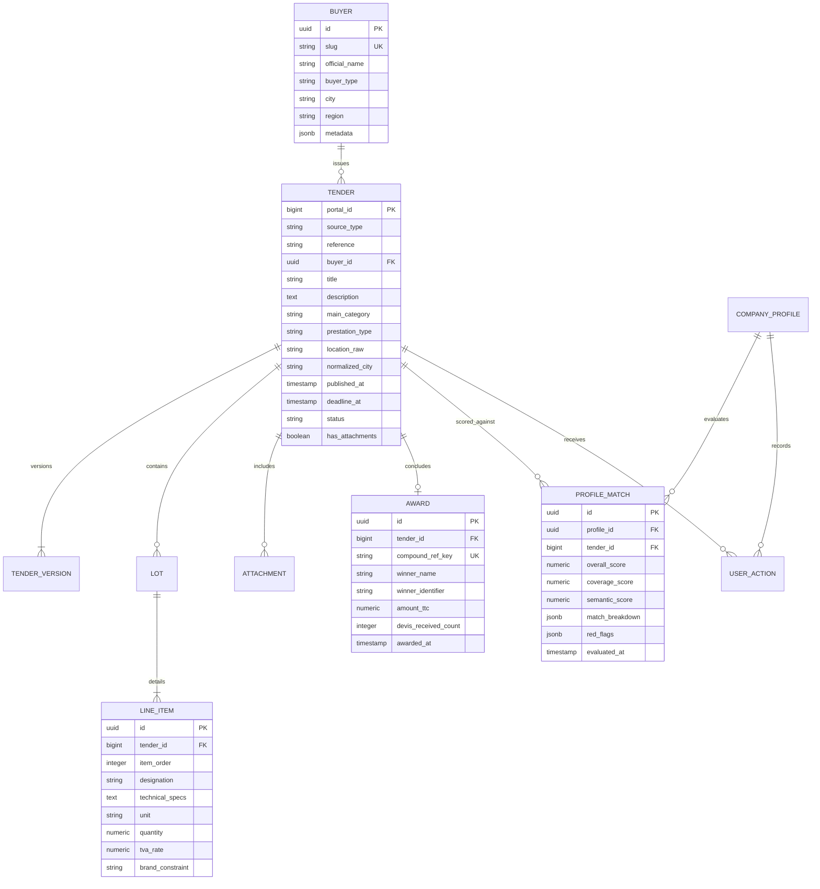
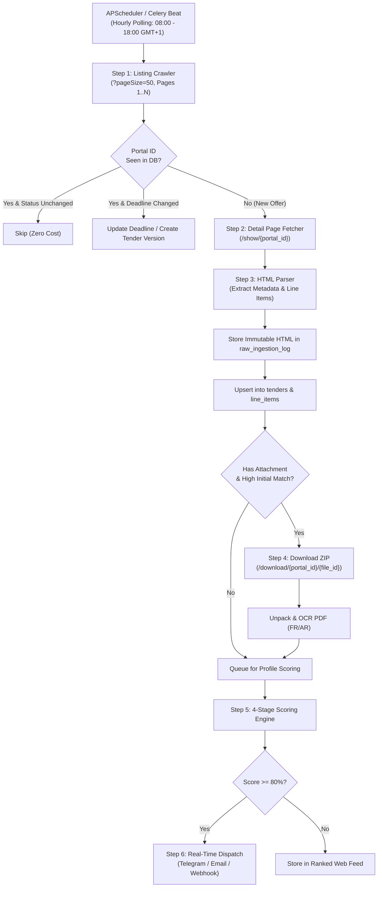
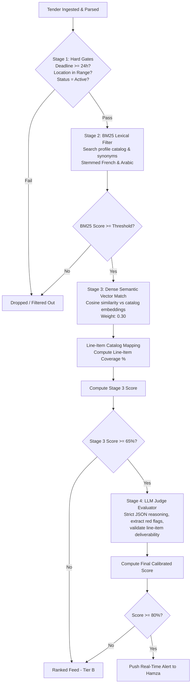

# Architectural Specification: Moroccan Public Procurement Intelligence System (BDC & Marchés Publics)

> [!TIP]
> **For AI Coding Agents & LLMs:**
> Do **not** load or read this entire 71 KB document into your context window. It burns ~20,000 tokens per read.
> Instead, refer to [`AGENTS.md`](./AGENTS.md) at root and the modular, progressive-disclosure guides in [`docs/`](./docs/README.md).

**Project:** Autonomous Opportunity Discovery & B2B Intelligence Engine for Moroccan Public Procurement  
**Target Platform:** Portail Marocain des Marchés Publics (`marchespublics.gov.ma` / TGR)  
**Author:** Principal Architect & Domain Specialist  
**Stakeholder / Founder:** Hamza (Technical Founder, Data & Software Solutions)  
**Date:** November 19, 2026  
**Document Status:** Living Architectural Blueprint — Version 1.0.0  

---

## 1. Document Control & Open Decisions

### 1.1 Changelog
| Version | Date | Author | Description of Changes |
| :--- | :--- | :--- | :--- |
| **v1.2.0** | 2026-11-19 | Architect | Implement Milestone 7: Interactive FastAPI web dashboard with responsive 60-Second Decision Card modal, profile switcher, real-time filters, and founder action logger. |
| **v1.1.0** | 2026-11-19 | Architect | Pivot notification channel from Telegram Bot to Gmail SMTP with responsive HTML Decision Cards. Updated Docker compose topology and alert dispatcher specs. |
| **v1.0.0** | 2026-11-19 | Architect | Initial comprehensive baseline. Integrates Phase 0 site recon findings, legal framework (Decree 2-22-431), WAF/F5 ASM discovery, layered data model, multi-industry profile engine, 4-stage matching cascade, and roadmap. |

### 1.2 Open Questions & Strategic Decisions Needed from Hamza
The following decisions require your review and explicit sign-off:

1. **Storage Engine Choice for MVP (ADR-001):**
   * *Option A (Recommended):* Single-node **PostgreSQL 16 + `pgvector` + `pg_trgm`** with Docker Compose. Handles relational joins, JSONB raw payloads, full-text French/Arabic search, and vector embeddings in one zero-maintenance process.
   * *Option B:* SQLite (`sqlite-vec` + FTS5) transitioning to PostgreSQL later.
   * *Decision Needed:* Sign off on Option A (simplifies migration and allows direct multi-worker polling without locking).
2. **First Profile to Test & Benchmark:**
   * *Software & Data Profile:* Strategic for your primary business, but active BDC volume is moderate (~3-5% of total BDC); requires deep line-item and attachment parsing.
   * *CCTV / Security Profile:* Abundant active BDC volume (~10-15% of supply/works BDC); explicit line items (cameras, DVRs, cabling); ideal for verifying 95% alignment precision.
   * *Decision Needed:* Confirm whether we deploy both simultaneously or lead testing with CCTV to calibrate the scoring engine before tuning the software/data profile.
3. **Attachment Download & OCR Policy:**
   * Direct `.zip` download is [VERIFIED] accessible as guest. Each `.zip` contains scanned or native PDFs.
   * *Decision Needed:* Should MVP download attachments *eagerly* for all matches passing stage 1 & 2 filters, or *lazily* only when the user opens the Decision Card? (Architect recommends: lazy background download for top candidates with score > 60).
4. **Historical Results Backfill Scope:**
   * Portal has ~340,000 historical award cards dating back to Oct 2023 [VERIFIED].
   * *Decision Needed:* Do we ingest all 340k records upfront (requiring ~3-4 days at 1 req/sec), or start with the latest 6 months (~50,000 awards) to prime the pricing benchmark engine?

---

## 2. Table of Contents
- [1. Document Control & Open Decisions](#1-document-control--open-decisions)
- [2. Table of Contents](#2-table-of-contents)
- [3. Executive Summary & System Vision](#3-executive-summary--system-vision)
- [4. Phase 0: Site Reconnaissance & Legal/Ethical Framework](#4-phase-0-site-reconnaissance--legalethical-framework)
  - [4.1 Legal & Regulatory Foundation (Decree 2-22-431)](#41-legal--regulatory-foundation-decree-2-22-431)
  - [4.2 Technical Anatomy & Portal Architecture](#42-technical-anatomy--portal-architecture)
  - [4.3 Exhaustive Field Inventory](#43-exhaustive-field-inventory)
  - [4.4 Portal Lifecycle & State Machine](#44-portal-lifecycle--state-machine)
- [5. Phase 1: Business Funnel & Decision-Maker Diagnosis](#5-phase-1-business-funnel--decision-maker-diagnosis)
  - [5.1 The 8-Stage Bidder Decision Funnel](#51-the-8-stage-bidder-decision-funnel)
  - [5.2 Hard Eligibility vs. Soft Fit](#52-hard-eligibility-vs-soft-fit)
  - [5.3 Practical Dynamics of Moroccan BDC Competitions](#53-practical-dynamics-of-moroccan-bdc-competitions)
  - [5.4 The 60-Second "Decision Card" Specification](#54-the-60-second-decision-card-specification)
  - [5.5 Mathematical Formalization of "~95% Aligned"](#55-mathematical-formalization-of-95-aligned)
- [6. Phase 2: Data Architecture & Storage Schema](#6-phase-2-data-architecture--storage-schema)
  - [6.1 Layered Storage Philosophy](#61-layered-storage-philosophy)
  - [6.2 Entity-Relationship (ER) Model](#62-entity-relationship-er-model)
  - [6.3 PostgreSQL DDL for MVP](#63-postgresql-ddl-for-mvp)
  - [6.4 Concrete JSON Sample Records](#64-concrete-json-sample-records)
- [7. Phase 3: Ingestion & Scraping Architecture](#7-phase-3-ingestion--scraping-architecture)
  - [7.1 Pipeline Topology & Component Contracts](#71-pipeline-topology--component-contracts)
  - [7.2 Anti-Bot / WAF Navigation & Politeness](#72-anti-bot--waf-navigation--politeness)
  - [7.3 Scheduling, Resiliency & DOM-Drift Detection](#73-scheduling-resiliency--dom-drift-detection)
  - [7.4 Attachment Ingestion & Multilingual OCR](#74-attachment-ingestion--multilingual-ocr)
  - [7.5 Build vs. Buy vs. Hybrid Analysis](#75-build-vs-buy-vs-hybrid-analysis)
- [8. Phase 4: Multi-Industry Profile Engine](#8-phase-4-multi-industry-profile-engine)
  - [8.1 Declarative Profile Schema (YAML Specification)](#81-declarative-profile-schema-yaml-specification)
  - [8.2 Benchmark Profile A: Software, Programming & Data Solutions](#82-benchmark-profile-a-software-programming--data-solutions)
  - [8.3 Benchmark Profile B: CCTV & Physical Security Systems](#83-benchmark-profile-b-cctv--physical-security-systems)
  - [8.4 Profile Bootstrapping & Active Calibration](#84-profile-bootstrapping--active-calibration)
- [9. Phase 5: Matching & Scoring Engine](#9-phase-5-matching--scoring-engine)
  - [9.1 4-Stage Filtering & Scoring Cascade](#91-4-stage-filtering--scoring-cascade)
  - [9.2 Line-Item Catalog Decomposition & Coverage](#92-line-item-catalog-decomposition--coverage)
  - [9.3 LLM Judge Prompt & Structured Output](#93-llm-judge-prompt--structured-output)
  - [9.4 Evaluation Protocol & Active Learning Loop](#94-evaluation-protocol--active-learning-loop)
- [10. Phase 6: Pricing Intelligence & Comparable Engine](#10-phase-6-pricing-intelligence--comparable-engine)
  - [10.1 The BDC Pricing Challenge & Realities](#101-the-bdc-pricing-challenge--realities)
  - [10.2 Comparable Retrieval & Price Band Formulation](#102-comparable-retrieval--price-band-formulation)
  - [10.3 Historical Result Joining Strategy](#103-historical-result-joining-strategy)
- [11. Phase 7: Product Surface & Workflow](#11-phase-7-product-surface--workflow)
- [12. Phase 8: Strategic Opportunity Intelligence](#12-phase-8-strategic-opportunity-intelligence)
- [13. Architectural Decision Records (ADRs)](#13-architectural-decision-records-adrs)

---

## 3. Executive Summary & System Vision

### 3.1 Context & Problem Statement
In Morocco, public procurement represents over 20% of GDP. Under **Decree n° 2-22-431**, public buyers (*maîtres d'ouvrage*) issue thousands of small, streamlined purchasing competitions called **Bons de Commande (BDC)** directly through the unified procurement portal (`marchespublics.gov.ma`), alongside formal tenders (*marchés publics* / *appels d'offres*).

For small and medium enterprises (SMEs) and specialized technical firms (software houses, CCTV installers, engineering offices), finding profitable tenders is plagued by:
1. **Low Signal-to-Noise Ratio:** Thousands of heterogeneous notices across hundreds of public entities (*communes*, ministries, public agencies / *établissements publics*).
2. **Aggressive Deadlines:** Legal publication window is often as short as **48 to 72 hours** [VERIFIED]. Missing a day means missing the bid.
3. **Opaque Pricing:** BDC awards are legally driven by the **lowest compliant bid (*moins disant*)** [VERIFIED]. Bidders have zero visibility into what competitors bid or what historical winning price bands look like.
4. **Manual Friction:** Downloading ZIP archives containing scanned PDFs and manually calculating margins across tens of line items.

### 3.2 Product Mission
To build an automated, multi-tenant intelligence pipeline that monitors the Moroccan procurement portal 24/7, extracts structured line items and attachments, scores offers against rich declarative company profiles, and delivers a **60-Second Decision Card** containing:
* Match alignment score (~95% calibrated probability of relevance).
* Line-item coverage and bill-of-materials breakdown.
* Buyer competition and payment history.
* Estimated winning price corridor and minimum profitable floor price.
* Direct submission checklist with deep links.

---

## 4. Phase 0: Site Reconnaissance & Legal/Ethical Framework



### 4.1 Legal & Regulatory Foundation (Decree 2-22-431)
*All legal findings below are tagged based on statutory texts in force as of November 2026:*

* **Governing Statute:** **Décret n° 2-22-431 du 15 chaabane 1444 (8 mars 2023) relatif aux marchés publics**, published in Bulletin Officiel n° 7176 and entered into force on September 1, 2023 [VERIFIED].
* **BDC Definition & Threshold (Article 91):**
  * Maximum annual ceiling: **500,000 MAD TTC (Toutes Taxes Comprises)** per budget year, per authorising officer (*ordonnateur* or *sous-ordonnateur*), for the same category of service [VERIFIED].
  * *Threshold Increase:* Revalued up from 200,000 MAD in the previous Decree 2-12-349.
  * *Splitting Prohibition:* Artificially splitting purchases (*saupoudrage* / *fractionnement*) to evade public tender procedures is illegal [VERIFIED].
* **Prestation Taxonomy (Annexe 4):**
  * Bon de commande purchases can only be made for prestations explicitly scheduled in **Annexe 4** of Decree 2-22-431 (supplies, standard maintenance, minor works, recurring standard services) [VERIFIED].
* **Mandatory Portal Publication Window (Article 91, Paragraph 3):**
  * The public buyer (*maître d'ouvrage*) is legally mandated to publish an **Avis d'achat sur bon de commande** on the procurement portal for a **minimum duration of 48 hours** [VERIFIED]. In observed practice, active publication windows range from 48 hours to 10 calendar days [VERIFIED].
* **Competition & Award Rule (Article 91, Paragraph 5):**
  * Minimum of 3 competitors must be consulted where feasible.
  * The award must be made to the **lowest compliant bid (*l'offre la moins disante*)** among technically compliant quotes (*devis*) [VERIFIED].
  * In the event of tied bids, regulatory preference is given to the local bidder whose business is registered or operating in the locality of execution [VERIFIED].

#### Operational & Ethical Guardrails (What the System Must NOT Do)
1. **No Automated Bid Submission:** The tool is purely an intelligence and decision-support system. It must **never** automate quote submission, form submission with digital signature (*certificat électronique Intelsign / Barid e-Trust*), or banking token entry. Bid submission remains 100% human.
2. **No WAF/Captcha Bypass Tools:** The tool will not deploy captcha-cracking, browser spoofing farms, or proxy-rotation attacks. It utilizes polite, standardized HTTP client requests adhering to natural human-like cadences.
3. **Personal Data Minimization:** Contact details (buyer names, civil service phones) and natural-person sole proprietors are sanitized. Database storage focuses strictly on legal entity names (*dénomination sociale*), commercial identifiers, and institutional buyer hierarchies.
4. **Crawl Politeness SLA:** Strictly **1 request per second** maximum per target host, with session cookie persistence, explicit User-Agent, and full backoff on HTTP 429/503.

---

### 4.2 Technical Anatomy & Portal Architecture

| Parameter | Observed Finding & Status | Implementation Impact |
| :--- | :--- | :--- |
| **Network Infrastructure & WAF** | **F5 BIG-IP Application Security Manager (ASM)** detected [VERIFIED]. Sets cookies `TS01c367b8`, `TS01c367b8028`, `DCOOKIE`, `SERVERID=server4`. Raw requests without realistic headers receive HTTP 403 Forbidden [VERIFIED]. Requests with standard browser headers and session cookie reuse receive HTTP 200 OK [VERIFIED]. | The scraper HTTP client must manage a persistent cookie jar, send canonical modern browser headers, and support HTTP/2 with TLS session reuse (e.g., Python `curl_cffi` or `httpx` with HTTP/2). |
| **Rendering Architecture** | **Server-Side Rendered (SSR) HTML** with Bootstrap 5 and jQuery 3.6.0 [VERIFIED]. Entire listings, tables, line items, and results are directly present in the initial HTML response. | **No headless browser (Playwright/Puppeteer) is needed** for ingestion. Low CPU footprint, deterministic execution, and fast parsing with `BeautifulSoup4` or `lxml`. |
| **Pagination & Sizing** | Pagination URL: `?page={n}` [VERIFIED]. Page size selector parameter: `search_consultation_entreprise[pageSize]` supporting 10, 20, 30, 50 items [VERIFIED]. | By setting `pageSize=50`, the ~1,600 active notices can be crawled in just **32 HTTP requests**, taking only ~40 seconds at 1 req/sec. |
| **Sorting & Drift Risk** | Default active listing sort order is **Closing Date Descending (`dateLimite`)**, NOT publication date [VERIFIED]. Notices leave the active list as deadlines expire. | Crawling page by page can cause item shift. *Mitigation:* Rapid sequential pass at `pageSize=50` combined with upsert on `portal_id`. |
| **Offer Identifiers** | URL format: `/bdc/entreprise/consultation/show/{portal_id}` where `portal_id` is a unique sequential integer (e.g. `409807`) [VERIFIED]. Internal reference strings (e.g. `06/2026`) are per-buyer local series and collide across different buyers [VERIFIED]. | Canonical Primary Key in our database: `portal_id`. Secondary Natural Key: `(buyer_slug, reference, year)`. |
| **Timezone & Dates** | Timestamps displayed as `dd/MM/yyyy HH:mm` (e.g. `27/11/2026 14:00`) [VERIFIED]. Timezone is Moroccan Standard Time (`Africa/Casablanca`, GMT+1). | All parsed datetimes must be explicitly localized to `Africa/Casablanca` before persisting as UTC `timestamptz`. |
| **Attachments** | Direct guest download URL: `/bdc/entreprise/consultation/download/{portal_id}/{file_id}` [VERIFIED]. Returns `application/zip` containing PDFs [VERIFIED]. | Attachments are 100% accessible without credentials. Download pipeline must verify file checksums and unpack asynchronously. |
| **Results Archive** | Located at `/bdc/entreprise/consultation/resultat` [VERIFIED]. ~340,000 records dating back to 2023 [VERIFIED]. Each card `<article class="bdc-card">` displays reference, title, buyer, status, devis count, winner name, and total TTC amount [VERIFIED]. | **Critical Recon Insight:** Result cards contain **no direct link or portal_id** to consultation detail pages [VERIFIED]. Merging results with active consultations requires compound natural key joining: `(buyer, reference, year)`. |

---

### 4.3 Exhaustive Field Inventory

The table below catalogs every data element visible across the BDC portal sections:

| Field Name (as displayed) | Internal Attribute | Observed Value Example | Data Type | Nullable | Source Section | Decision Value | Notes & Analysis |
| :--- | :--- | :--- | :--- | :--- | :--- | :--- | :--- |
| **Numéro d'avis / ID** | `portal_id` | `409807` | Integer | No | Listing / Detail | **Critical** | Unique portal key. Stable URL parameter. |
| **Référence** | `reference` | `06/2026` | String(64) | No | Listing / Detail / Results | High | Buyer-specific serial number; prone to cross-buyer collisions. |
| **Statut (Badge)** | `status` | `En cours`, `Annulé`, `Attribué`, `Infructueux` | Enum | No | Listing / Detail / Results | High | "Annulé" notices appear in active listings as cancellations. |
| **Objet** | `title` | `Achat et pose de caméra de surveillance...` | Text | No | Listing / Detail / Results | High | Free-text narrative, 1 sentence to 2 paragraphs. Primary search target. |
| **Acheteur public** | `buyer_name` | `Commune rurale de RDADNA O. MALEK` | String(255) | No | Listing / Detail / Results | **Critical** | Entity identity; requires fuzzy normalization into a canonical `buyers` table. |
| **Lieu d'exécution** | `location_text` | `BENSLIMANE`, or list of provinces | Text / Array | Yes | Listing / Detail | High | Can be a single city or national scope (~75 provinces). |
| **Date mise en ligne** | `published_at` | `18/11/2026 16:15` | Timestamp | No | Detail / Results | Medium | Publication start; used to measure freshness lag. |
| **Date limite réception devis** | `deadline_at` | `27/11/2026 14:00` | Timestamp | No | Listing / Detail | **Critical** | Hard deadline for quote receipt. Driving countdown clock. |
| **Catégorie principale** | `category` | `Fournitures`, `Travaux`, `Services` | Enum | No | Detail | Medium | Macro-category; not granular enough on its own. |
| **Nature de prestation** | `prestation_type` | `Travaux d'installation de matériels divers` | String(255) | Yes | Detail | High | ~300 standardized administrative classifications. Useful pre-filter. |
| **Service acheteur** | `buyer_department`| `Division Technique` | String(255) | Yes | Search / Detail | Low | Internal sub-department of buyer. |
| **Pièces jointes** | `attachment_url` | `/download/409807/55593536` | String | Yes | Detail | High | Direct download link for the tender ZIP package. |
| **Numéro d'article** | `item_number` | `1`, `2`, `3` | Integer | No | Detail (Table) | High | Order in the line-item bill of quantities (*bordereau*). |
| **Désignation article** | `item_designation`| `Caméra de surveillance fixe 5MP` | Text | No | Detail (Table) | **Critical** | Line-item product name; key for catalog matching. |
| **Spécifications techniques**| `item_specs` | `Marque HIKVISION ou similaire, vision nocturne 30m` | Text | Yes | Detail (Table) | **Critical** | Exact technical constraints, brands, models. |
| **Unité** | `unit` | `Unité`, `Mètre`, `Forfait`, `Jour` | String(32) | No | Detail (Table) | High | Pricing unit. Standardized across public purchases. |
| **Quantité** | `quantity` | `14.00`, `300.00` | Numeric | No | Detail (Table) | **Critical** | Volume needed. Multiplied by catalog unit price. |
| **Taux TVA** | `tva_rate` | `20%`, `10%`, `0%` | Numeric | No | Detail (Table) | Medium | Tax rate applied to line item. |
| **Garanties exigées** | `warranty_terms` | `Garantie de 12 mois avec SAV sur site` | Text | Yes | Detail (Table) | High | Operational obligation (e.g. 1-3 years warranty). |
| **Nombre de devis reçus**| `bids_count` | `16`, `52` | Integer | Yes | Results | **Critical** | Competition density indicator (market saturation metric). |
| **Entreprise attributaire** | `winner_name` | `TOUDA EXPLO SARL` | String(255) | Yes | Results | **Critical** | Competitor intelligence key. Maps who wins where. |
| **Montant TTC** | `awarded_amount_ttc` | `19 008,00 MAD` | Numeric | Yes | Results | **Critical** | Realized market price benchmark. |

*Verified Absences from Public Guest View:*
* Public buyers do NOT publish their confidential internal estimated cost (*estimation du maître d'ouvrage*) for BDC [VERIFIED].
* Provisional bid bonds (*cautionnement provisoire*) are generally exempted for BDC under Decree 2-22-431 [VERIFIED].
* Specific civil servant contact details (names, direct personal phone numbers) are hidden [VERIFIED].

---

### 4.4 Portal Lifecycle & State Machine



---

## 5. Phase 1: Business Funnel & Decision-Maker Diagnosis

### 5.1 The 8-Stage Bidder Decision Funnel
For an SME founder or bid manager, bidding on Moroccan public tenders represents an investment of time, compliance risk, and potential working capital lockup. The system models the bidder journey as a structured 8-stage funnel:



The system provides targeted data to answer each stage's critical question:

| Funnel Stage | Decision Maker's Core Question | Data Points Answering the Question | System Automated Output |
| :--- | :--- | :--- | :--- |
| **1. Discover** | Is there an active consultation matching my core domain published in the last 24h? | Title, category, `naturePrestation`, line items, `published_at`. | Real-time push alert (Telegram/Email/Feed) with match score. |
| **2. Qualify (Fit)** | What percentage of the requested items can my company actually source or deliver? | Line-item designations, technical specifications, quantities, units. | **Line-Item Coverage Score** (e.g. 100% CCTV, 0% civil works). |
| **3. Feasibility** | Can I physically deliver to this province before the deadline without prohibitive logistical costs? | `lieuExecution`, execution delay in specifications, remaining hours. | **Feasibility Matrix** (Distance check, time countdown, red flags). |
| **4. Price** | What is the historical price ceiling, and what did competitors win this for in previous awards? | Results archive: median TTC for similar objects, buyer's budget history. | **Price Corridor** (Target winning bid range, floor price). |
| **5. Decide** | Is the expected value ($P_{\text{win}} \times \text{Margin} - \text{Bid Cost}$) positive and worth staff time? | Bids count (competition density), buyer payment reputation, net margin. | **Go / No-Go Verdict** (Score > 80 = Recommended GO). |
| **6. Prepare** | What mandatory documents, bank RIB, and sample certifications are requested in the tender package? | Attachment text extraction: DQE, Bordereau des prix, CPS clauses. | **Preparation Checklist** (Pre-filled quote template & document pack). |
| **7. Submit** | Where do I upload and when is the absolute portal cutoff? | Portal direct submission URL, precise countdown clock. | **One-Click Deep Link** directly into portal consultation ID. |
| **8. Learn** | Who won this BDC, at what price, and why did my bid succeed/fail? | Post-award scraping of `/resultat` joined back to `portal_id`. | **Post-Mortem Analysis** (Competitor benchmarking & strategy update). |

---

### 5.2 Hard Eligibility vs. Soft Fit

The system separates filtering into two distinct tiers: **Non-negotiable Hard Gates** (binary pass/fail) and **Probabilistic Soft Fit** (continuous score 0–100):

#### Tier 1: Hard Eligibility Filters (Binary Disqualifiers)
If an offer fails *any* hard filter, it is dropped immediately before invoking expensive vector embeddings or LLM evaluations:
1. **Status Gate:** Must be active (`status != 'Annulé'`).
2. **Deadline Gate:** `deadline_at` must be at least $T_{\text{min}}$ hours in the future (default: 12 hours, configurable per company profile to prevent rushing unfeasible quotes).
3. **Geographic Coverage:** `lieuExecution` must overlap with the company's serviceable provinces/regions (e.g. "Casablanca-Settat", "Rabat-Salé-Kénitra", or "National").
4. **Amount Ceiling:** Total estimated volume must fall within the company's financial capability (cannot exceed the statutory 500,000 MAD BDC cap; lower min/max thresholds configurable per profile).
5. **Regulatory / License Blacklist:** If attached specifications require mandatory certifications the company does not hold (e.g. CNDP authorization, Agrément Technique for class 1 telecommunications), the offer is filtered or flagged with a hard blocker.

#### Tier 2: Soft Fit Signals (Weighted Probabilistic Alignment)
For offers passing Tier 1, the system computes multi-dimensional soft scores:
* **Semantic Vector Similarity:** Cosine distance between offer description/line items and company catalog embeddings.
* **Line-Item Coverage Ratio:** Percentage of total line items matched to catalog SKUs with confidence > 0.85.
* **Buyer Attractiveness:** Calculated from buyer's historical BDC frequency, cancellation rate, and promptness of award publication.
* **Competitive Saturation:** Historical average number of competing quotes submitted for this buyer and category (e.g. 5 competitors = high appeal; 45 competitors = intense price war).

---

### 5.3 Practical Dynamics of Moroccan BDC Competitions

Operating successfully in the Moroccan BDC market requires understanding the economic mechanics on the ground:
1. **Low-Friction Quotation:** Unlike formal *marchés publics* which require physical wax-sealed envelopes, bank guarantees (*cautionnement provisoire*), and complex administrative dossiers (*dossier administratif, technique et additif*), BDC response is submitted digitally as a single standardized quote (*devis*) on the portal [VERIFIED].
2. **Extreme Price Sensitivity (*Le Moins-Disant*):** Awarding officers have zero legal discretion to choose a higher-quality product if the lowest bidder meets the minimum specification written in the table (Article 91) [VERIFIED].
3. **Specification Traps:** Buyers frequently specify exact commercial brand names (e.g. *"Caméra HIKVISION ou similaire"*, *"Serveur DELL PowerEdge"*, *"Licence Microsoft Office"*). Bidders who carry alternate brands must verify compliance with the "ou similaire" clause.
4. **Freshness SLA:** Because buyers can legally close an offer within 48 hours [VERIFIED], an intelligence tool running on a daily batch is too slow. Crawling must run on a **1-hour polling cadence** during Moroccan business hours (08:00 to 18:00 UTC+1), with instant alert dispatch within 5 minutes of publication.

---

### 5.4 The 60-Second "Decision Card" Specification

A founder or bid manager should never have to read through 15 pages of administrative jargon to decide whether to bid. The system synthesizes every consultation into a standardized, single-screen **Decision Card**:

```
+----------------------------------------------------------------------------------------------------+
|  PORTAL ID: #409807  |  REF: 06/2026  |  DEADLINE: 27 Nov 2026 14:00 (5d 18h remaining)            |
|  BUYER: Commune rurale de RDADNA O. MALEK (Benslimane)                |  STATUS: ACTIF             |
+----------------------------------------------------------------------------------------------------+
|  OVERALL MATCH: 94% [HIGH PRIORITY]  |  EST. WINNING CORRIDOR: 68,000 - 74,000 MAD TTC             |
+----------------------------------------------------------------------------------------------------+
|  TITLE: Achat et pose de caméra de surveillance pour le siège de la commune                       |
|  CATEGORY: Fournitures / Installation de matériels divers                                          |
+----------------------------------------------------------------------------------------------------+
|  LINE-ITEM COVERAGE (4 / 4 items matched - 100% catalog coverage):                                 |
|   [x] Item 1: Caméra IP 5MP Tube IR 30m (Hikvision ou similaire)      | Qty: 14 U   | Unit est: 650 MAD    |
|   [x] Item 2: NVR 16 Canaux 4K PoE                                    | Qty: 1 U    | Unit est: 2,400 MAD  |
|   [x] Item 3: Disque Dur Surveillance 4TB (WD Purple ou similaire)    | Qty: 4 U    | Unit est: 1,100 MAD  |
|   [x] Item 4: Câble Réseau CAT6 UTP Cuivre                            | Qty: 300 m  | Unit est: 6 MAD/m    |
+----------------------------------------------------------------------------------------------------+
|  COMMERCIAL & COMPETITIVE INTELLIGENCE:                                                             |
|   * Buyer Competition: Moderate (Avg 12 devis received across 8 historical BDCs)                   |
|   * Historical Benchmark: Similar 16-cam installation awarded at 71,200 MAD TTC in Oct 2026        |
|   * Estimated Internal Cost: 48,500 MAD HT | Projected Gross Margin at winning price: ~31%          |
+----------------------------------------------------------------------------------------------------+
|  RED FLAGS & PREREQUISITES:                                                                        |
|   (!) On-site warranty required: 12 months with 48h SLA response.                                   |
|   (!) Execution locality: Benslimane (35 km from Casablanca hub - Low travel overhead).            |
+----------------------------------------------------------------------------------------------------+
|  ACTIONS:                                                                                          |
|   [ View Original Portal Notice ]  [ Download Spec ZIP (246 KB) ]  [ Generate Draft Devis (CSV) ]   |
+----------------------------------------------------------------------------------------------------+
```

---

### 5.5 Mathematical Formalization of "~95% Aligned"

In enterprise search, stating that an offer is "95% aligned" cannot be an arbitrary heuristic. We formalize this as a **calibrated composite fitness score**:

$$\text{Alignment Score } S = \sum_{k} w_k \cdot \sigma_k \in [0, 100]$$

Where:
* **$\sigma_{\text{coverage}} \in [0, 100]$ (Weight: 0.40):** Line-Item Coverage Ratio.
  $$\sigma_{\text{coverage}} = \frac{\sum_{i \in \text{Matched Items}} \text{Value}_i}{\sum_{j \in \text{All Items}} \text{Value}_j} \times 100$$
  If an offer requires 10 line items and the user can supply only 6 (representing 55% of the estimated contract value), $\sigma_{\text{coverage}} = 55$. An offer can never reach "95% alignment" if critical line items cannot be supplied.
* **$\sigma_{\text{semantic}} \in [0, 100]$ (Weight: 0.30):** Cosine similarity between multilingual embeddings of the profile offering catalog and the tender specifications:
  $$\sigma_{\text{semantic}} = \max\left(0, \cos(\mathbf{e}_{\text{offer}}, \mathbf{e}_{\text{catalog}})\right) \times 100$$
* **$\sigma_{\text{feasibility}} \in [0, 100]$ (Weight: 0.15):** Geographic proximity decay function and lead-time sufficiency:
  $$\sigma_{\text{feasibility}} = 100 \cdot \exp\left(-\frac{\text{distance\_km}}{200}\right) \cdot \mathbb{I}(\text{deadline} \ge T_{\text{min}})$$
* **$\sigma_{\text{commercial}} \in [0, 100]$ (Weight: 0.15):** Profitability index combining historical competition intensity and projected margin:
  $$\sigma_{\text{commercial}} = 100 \cdot \frac{\text{Projected Margin \%}}{\text{Target Margin \%}} \cdot \left(1 - \frac{\text{Avg Bidders}}{50}\right)$$

**Calibration Condition:** An offer displaying **"$\ge 95\%$ Alignment"** guarantees:
1. $100\%$ of mandatory technical line items are serviceable by the company.
2. Zero negative/exclusion keywords detected in specifications.
3. Execution site is within the company's designated operational territory.
4. Estimated gross margin exceeds the company's hurdle rate ($> 25\%$).
5. Probability of the user clicking "Shortlist" or "Bid" in production exceeds $0.90$ ($Precision@10 \ge 0.90$).

---

## 6. Phase 2: Data Architecture & Storage Schema



### 6.1 Layered Storage Philosophy
The system implements a four-tiered data storage pattern to decouple ingestion from inference and allow full historical re-parsing without hitting the portal:

1. **Raw Layer (`raw_pages`, `raw_attachments`):**
   * Immutable, append-only cold storage.
   * Stores the unparsed raw HTML, HTTP response headers, compression type, SHA-256 payload hash, and scraper metadata.
   * *Purpose:* When the portal DOM changes or a new extraction model is deployed, the entire historical archive can be re-parsed locally without issuing a single network request.
2. **Normalized Layer (`tenders`, `line_items`, `buyers`, `awards`, `attachments`):**
   * Clean, source-agnostic relational schema covering BDC and future Marchés Publics / AO.
   * Strongly typed, foreign-key enforced, deduplicated, and temporal-aware (handles amendments and deadline updates).
3. **Enriched Layer (`tender_embeddings`, `document_texts`, `extracted_entities`):**
   * Language identification (French, Standard Arabic, Moroccan Darija transliterations).
   * Dense vector embeddings (OpenAI `text-embedding-3-small` or multilingual E5) generated per line item and per tender.
   * Extracted entities: specific brands requested, model numbers, warranty constraints, ISO/technical standards.
4. **Decision Layer (`company_profiles`, `profile_matches`, `price_estimates`, `user_actions`):**
   * Multi-tenant domain tables holding company configs, scoring results, matched line-item mappings, and founder action feedback (shortlisted, skipped, bid, won, lost).

---

### 6.2 PostgreSQL DDL for MVP

```sql
-- PostgreSQL 16 Schema with pgvector and pg_trgm extensions
CREATE EXTENSION IF NOT EXISTS "uuid-ossp";
CREATE EXTENSION IF NOT EXISTS "pg_trgm";
CREATE EXTENSION IF NOT EXISTS "vector";

-- 1. RAW LAYER
CREATE TABLE raw_ingestion_log (
    id UUID PRIMARY KEY DEFAULT uuid_generate_v4(),
    source_url TEXT NOT NULL,
    portal_id BIGINT,
    page_type VARCHAR(32) NOT NULL, -- 'listing', 'detail', 'result'
    http_status INT NOT NULL,
    html_content TEXT NOT NULL,
    content_hash CHAR(64) NOT NULL, -- SHA-256
    scraper_version VARCHAR(16) NOT NULL,
    fetched_at TIMESTAMPTZ NOT NULL DEFAULT NOW()
);
CREATE INDEX idx_raw_portal_id ON raw_ingestion_log(portal_id);
CREATE INDEX idx_raw_content_hash ON raw_ingestion_log(content_hash);

-- 2. NORMALIZED LAYER: BUYERS
CREATE TABLE buyers (
    id UUID PRIMARY KEY DEFAULT uuid_generate_v4(),
    slug VARCHAR(255) UNIQUE NOT NULL,
    official_name TEXT NOT NULL,
    buyer_type VARCHAR(64) NOT NULL, -- 'commune', 'ministere', 'etablissement_public', 'societe_etat'
    region VARCHAR(64),
    city VARCHAR(64),
    created_at TIMESTAMPTZ NOT NULL DEFAULT NOW(),
    updated_at TIMESTAMPTZ NOT NULL DEFAULT NOW()
);
CREATE INDEX idx_buyers_name_trgm ON buyers USING gin (official_name gin_trgm_ops);

-- 3. NORMALIZED LAYER: TENDERS
CREATE TABLE tenders (
    portal_id BIGINT PRIMARY KEY, -- The official portal consultation ID (e.g. 409807)
    source_type VARCHAR(32) NOT NULL DEFAULT 'bdc', -- 'bdc' or 'marche_public'
    reference VARCHAR(64) NOT NULL,
    compound_natural_key VARCHAR(255) NOT NULL, -- 'buyer_slug:reference:year'
    buyer_id UUID NOT NULL REFERENCES buyers(id) ON DELETE RESTRICT,
    title TEXT NOT NULL,
    main_category VARCHAR(32) NOT NULL, -- 'Fournitures', 'Travaux', 'Services'
    prestation_type TEXT,
    execution_location TEXT,
    normalized_city VARCHAR(64),
    normalized_region VARCHAR(64),
    published_at TIMESTAMPTZ NOT NULL,
    deadline_at TIMESTAMPTZ NOT NULL,
    status VARCHAR(32) NOT NULL DEFAULT 'active', -- 'active', 'annule', 'cloture', 'attribue'
    attachment_available BOOLEAN NOT NULL DEFAULT FALSE,
    attachment_url TEXT,
    created_at TIMESTAMPTZ NOT NULL DEFAULT NOW(),
    updated_at TIMESTAMPTZ NOT NULL DEFAULT NOW()
);
CREATE INDEX idx_tenders_deadline ON tenders(deadline_at);
CREATE INDEX idx_tenders_status_deadline ON tenders(status, deadline_at) WHERE status = 'active';
CREATE INDEX idx_tenders_title_trgm ON tenders USING gin (title gin_trgm_ops);
CREATE INDEX idx_tenders_natural_key ON tenders(compound_natural_key);

-- 4. NORMALIZED LAYER: LINE ITEMS (ARTICLES)
CREATE TABLE line_items (
    id UUID PRIMARY KEY DEFAULT uuid_generate_v4(),
    tender_id BIGINT NOT NULL REFERENCES tenders(portal_id) ON DELETE CASCADE,
    item_order INT NOT NULL,
    designation TEXT NOT NULL,
    technical_specs TEXT,
    unit VARCHAR(32) NOT NULL DEFAULT 'U',
    quantity NUMERIC(12, 2) NOT NULL,
    tva_rate NUMERIC(5, 2) DEFAULT 20.00,
    warranty_required TEXT,
    extracted_brand VARCHAR(128),
    created_at TIMESTAMPTZ NOT NULL DEFAULT NOW()
);
CREATE INDEX idx_line_items_tender ON line_items(tender_id);
CREATE INDEX idx_line_items_designation_trgm ON line_items USING gin (designation gin_trgm_ops);

-- 5. NORMALIZED LAYER: AWARDS / RESULTS
CREATE TABLE awards (
    id UUID PRIMARY KEY DEFAULT uuid_generate_v4(),
    tender_id BIGINT REFERENCES tenders(portal_id) ON DELETE SET NULL,
    compound_ref_key VARCHAR(255) NOT NULL, -- Used to link with tenders when portal_id is unlinked
    reference VARCHAR(64) NOT NULL,
    buyer_name_raw TEXT NOT NULL,
    title_raw TEXT NOT NULL,
    winner_name TEXT NOT NULL,
    winner_identifier VARCHAR(64), -- ICE or Tax ID if extracted
    amount_ttc NUMERIC(15, 2) NOT NULL,
    devis_received_count INT,
    status VARCHAR(32) NOT NULL, -- 'Attribué', 'Infructueux'
    published_at TIMESTAMPTZ NOT NULL,
    scraped_at TIMESTAMPTZ NOT NULL DEFAULT NOW()
);
CREATE INDEX idx_awards_tender_id ON awards(tender_id);
CREATE INDEX idx_awards_compound_key ON awards(compound_ref_key);
CREATE INDEX idx_awards_winner_trgm ON awards USING gin (winner_name gin_trgm_ops);

-- 6. ENRICHED LAYER: VECTOR EMBEDDINGS
CREATE TABLE tender_embeddings (
    tender_id BIGINT PRIMARY KEY REFERENCES tenders(portal_id) ON DELETE CASCADE,
    embedding vector(1536), -- Dimension for text-embedding-3-small
    embedded_content_hash CHAR(64) NOT NULL,
    updated_at TIMESTAMPTZ NOT NULL DEFAULT NOW()
);
CREATE INDEX idx_tender_embeddings_vector ON tender_embeddings USING hnsw (embedding vector_cosine_ops);

-- 7. DECISION LAYER: PROFILES & SCORING
CREATE TABLE company_profiles (
    id UUID PRIMARY KEY DEFAULT uuid_generate_v4(),
    tenant_id VARCHAR(64) NOT NULL,
    profile_name VARCHAR(128) NOT NULL,
    config_yaml TEXT NOT NULL,
    is_active BOOLEAN NOT NULL DEFAULT TRUE,
    created_at TIMESTAMPTZ NOT NULL DEFAULT NOW(),
    updated_at TIMESTAMPTZ NOT NULL DEFAULT NOW()
);

CREATE TABLE profile_matches (
    id UUID PRIMARY KEY DEFAULT uuid_generate_v4(),
    profile_id UUID NOT NULL REFERENCES company_profiles(id) ON DELETE CASCADE,
    tender_id BIGINT NOT NULL REFERENCES tenders(portal_id) ON DELETE CASCADE,
    overall_score NUMERIC(5, 2) NOT NULL, -- 0.00 to 100.00
    coverage_score NUMERIC(5, 2) NOT NULL,
    semantic_score NUMERIC(5, 2) NOT NULL,
    feasibility_score NUMERIC(5, 2) NOT NULL,
    commercial_score NUMERIC(5, 2) NOT NULL,
    decision_recommendation VARCHAR(16) NOT NULL, -- 'GO', 'CONSIDER', 'NO-GO'
    line_item_matches JSONB NOT NULL,
    red_flags JSONB DEFAULT '[]'::JSONB,
    llm_reasoning TEXT,
    evaluated_at TIMESTAMPTZ NOT NULL DEFAULT NOW(),
    UNIQUE(profile_id, tender_id)
);
CREATE INDEX idx_profile_matches_score ON profile_matches(profile_id, overall_score DESC);

CREATE TABLE user_tender_actions (
    id UUID PRIMARY KEY DEFAULT uuid_generate_v4(),
    profile_id UUID NOT NULL REFERENCES company_profiles(id) ON DELETE CASCADE,
    tender_id BIGINT NOT NULL REFERENCES tenders(portal_id) ON DELETE CASCADE,
    action VARCHAR(32) NOT NULL, -- 'viewed', 'shortlisted', 'bidded', 'won', 'lost', 'rejected'
    rejection_reason VARCHAR(64),
    user_notes TEXT,
    actioned_at TIMESTAMPTZ NOT NULL DEFAULT NOW(),
    UNIQUE(profile_id, tender_id, action)
);
```

---

### 6.3 Concrete JSON Sample Records

#### Sample 1: Active CCTV Supply & Installation Consultation (`portal_id: 409807`)
```json
{
  "portal_id": 409807,
  "source_type": "bdc",
  "reference": "06/2026",
  "compound_natural_key": "commune-rurale-de-rdadna-o-malek:06-2026:2026",
  "buyer": {
    "official_name": "Commune rurale de RDADNA O. MALEK",
    "buyer_type": "commune",
    "province": "Benslimane",
    "region": "Casablanca-Settat"
  },
  "title": "Achat et pose de caméra de serveillance",
  "main_category": "Fournitures",
  "prestation_type": "Travaux d'installation de matériels divers",
  "execution_location": "Siège de la Commune rurale de RDADNA O. MALEK",
  "published_at": "2026-11-18T16:15:00+01:00",
  "deadline_at": "2026-11-27T14:00:00+01:00",
  "status": "active",
  "attachment": {
    "filename": "Avis d'achat caméra de serveillance 06-2026.zip",
    "download_url": "/bdc/entreprise/consultation/download/409807/55593536",
    "files_inside": ["Avis d'achat caméra de serveillance 06-2026.pdf"],
    "size_bytes": 246884
  },
  "line_items": [
    {
      "item_order": 1,
      "designation": "Caméra tube IP 5MP IR 30m",
      "technical_specs": "Caméra réseau focale fixe 2.8mm, indice IP67, vision nocturne Smart IR 30m, marque HIKVISION ou similaire",
      "unit": "Unité",
      "quantity": 14.0,
      "tva_rate": 20.0,
      "warranty_required": "Garantie 12 mois minimum"
    },
    {
      "item_order": 2,
      "designation": "Enregistreur NVR 16 Voies 4K",
      "technical_specs": "NVR 16 canaux supportant caméras 8MP/5MP, 2 emplacements SATA jusqu'à 10TB par disque, switch PoE intégré",
      "unit": "Unité",
      "quantity": 1.0,
      "tva_rate": 20.0,
      "warranty_required": "Garantie 12 mois minimum"
    },
    {
      "item_order": 3,
      "designation": "Disque Dur Interne 4To Surveillance",
      "technical_specs": "Disque dur 3.5 pouces 24/7 de classe surveillance (Western Digital Purple ou Seagate SkyHawk)",
      "unit": "Unité",
      "quantity": 4.0,
      "tva_rate": 20.0,
      "warranty_required": "Garantie constructeur 3 ans"
    },
    {
      "item_order": 4,
      "designation": "Câble réseau UTP Catégorie 6",
      "technical_specs": "Câble 4 paires 100% cuivre, bobine extérieure résistante aux UV",
      "unit": "Mètre",
      "quantity": 300.0,
      "tva_rate": 20.0,
      "warranty_required": null
    }
  ]
}
```

#### Sample 2: Historical Award Notice (`/bdc/entreprise/consultation/resultat`)
```json
{
  "award_id": "8f8b89e3-2e4a-4632-9cb8-b570cbcf30da",
  "tender_id": null,
  "compound_ref_key": "commune-rurale-de-siroua:35-2026:2026",
  "reference": "35/2026",
  "buyer_name_raw": "Commune rurale de SIROUA",
  "title_raw": "Achat des fournitures de bureau au profit de la commune siroua.",
  "status": "Attribué",
  "devis_received_count": 16,
  "winner_name": "TOUDA EXPLO",
  "winner_identifier": null,
  "amount_ttc": 19008.00,
  "currency": "MAD",
  "published_at": "2026-11-19T14:34:00+01:00",
  "scraped_at": "2026-11-19T14:36:14Z"
}
```

---

## 7. Phase 3: Ingestion & Scraping Architecture



### 7.1 Pipeline Topology & Component Contracts
1. **Discovery (Listing Crawl):**
   * Target: `/bdc/entreprise/consultation/?search_consultation_entreprise[pageSize]=50&page={n}`.
   * Input: None.
   * Output: Stream of candidate cards containing `portal_id`, `reference`, `title`, `buyer_name`, `deadline_at`, `status`.
   * Exit Condition: When reaching page where all items already exist in database with matching `deadline_at` and `status`.
2. **Detail Page Fetch & Extraction:**
   * Target: `/bdc/entreprise/consultation/show/{portal_id}`.
   * Contract: Extracts tabular line items, unit, quantity, TVA rate, warranty conditions, execution location, and attachment URLs.
   * Failure Mode: If page returns HTTP 404 or redirect, mark tender as `withdrawn`. If table structure fails parsing, log DOM-drift alert and store raw HTML.
3. **Attachment Processing:**
   * Target: `/bdc/entreprise/consultation/download/{portal_id}/{file_id}`.
   * Contract: Downloads `.zip` archive, verifies file integrity, extracts enclosed PDFs/DOCXs, performs text extraction via `pypdf`/`pdfplumber`. If scanned bitmap, passes through Tesseract OCR with `fra+ara` language models.
4. **Scoring & Notification Dispatch:**
   * Contract: Executes the 4-stage cascade against all active tenant company profiles. If composite score exceeds notification threshold (default 80%), delivers structured Decision Card via Telegram Bot and Webhook within 120 seconds of ingestion.

---

### 7.2 Anti-Bot / WAF Navigation & Politeness
* [VERIFIED] Portal is shielded by an **F5 BIG-IP ASM Web Application Firewall**.
* *Technical Policy:*
  1. **Persistent Session Jar:** Maintain cookies (`TS01c367b8`, `DCOOKIE`, `SERVERID`) across all requests within a worker run.
  2. **Browser Fingerprint Mimicry:** Utilize `curl_cffi` (impersonating Chrome 120+) or `httpx` with exact HTTP/2 headers:
     ```python
     HEADERS = {
         "User-Agent": "Mozilla/5.0 (Windows NT 10.0; Win64; x64) AppleWebKit/537.36 (KHTML, like Gecko) Chrome/120.0.0.0 Safari/537.36",
         "Accept": "text/html,application/xhtml+xml,application/xml;q=0.9,image/avif,image/webp,*/*;q=0.8",
         "Accept-Language": "fr-FR,fr;q=0.9,ar;q=0.8,en-US;q=0.7,en;q=0.6",
         "Sec-Ch-Ua": '"Not_A Brand";v="8", "Chromium";v="120", "Google Chrome";v="120"',
         "Sec-Ch-Ua-Mobile": "?0",
         "Sec-Ch-Ua-Platform": '"Windows"',
         "Sec-Fetch-Dest": "document",
         "Sec-Fetch-Mode": "navigate",
         "Sec-Fetch-Site": "same-origin",
         "Sec-Fetch-User": "?1"
     }
     ```
  3. **Rate Limiting:** Jittered delay of $1.0 \pm 0.3$ seconds between consecutive requests. Circuit breaker trips immediately if two consecutive HTTP 403 or 429 status codes occur.

---

### 7.3 Scheduling, Resiliency & DOM-Drift Detection
* **Adaptive Polling Cadence:**
  * Active Hours (08:00 - 18:00 UTC+1, Mon-Fri): Poll listing every 60 minutes.
  * Off-Peak & Weekends: Poll listing every 4 hours.
  * Results Ingestion: Daily backfill pass at 20:00 UTC+1.
* **Golden Fixture Regression Testing:**
  * Maintain saved local HTML fixtures (`test_listing_p1.html`, `test_detail_409807.html`, `test_results_p1.html`).
  * Automated daily unit test runs parsers against golden fixtures. If the live scraper extracts 0 line items on 3 consecutive detail pages where `status = active`, raise a critical `SITE_STRUCTURE_DRIFT` alarm.

---

### 7.4 Attachment Ingestion & Multilingual OCR
Many public buyers in Moroccan rural communes scan paper consultation documents containing Arabic and French tables.
* **OCR Stack:**
  * Engine: `pytesseract` backed by `tesseract-ocr-fra` and `tesseract-ocr-ara`.
  * Preprocessing: Image thresholding with `OpenCV` (dewarping, contrast enhancement, Otsu binarization).
  * Fast-Path Bypass: Check PDF streams with `pdfplumber` first. If native digital font text is found (> 100 alphanumeric characters per page), skip OCR entirely to save CPU cycles.

---

### 7.5 Build vs. Buy vs. Hybrid Analysis

| Approach | Monthly Cost (USD) | Engineering Effort | Portal Drift Risk | Domain Fit for Moroccan BDC | Recommendation & Verdict |
| :--- | :--- | :--- | :--- | :--- | :--- |
| **A. Commercial Aggregator (e.g. Marchés-Securise, Local Tender Feeds)** | \$150 - \$400/mo | Low (API integration) | Low (Aggregator maintains scraper) | **Poor:** Most aggregators focus strictly on large Marchés/AO; they omit BDC line items and do not provide structured BOM tables. | Rejected. Does not solve line-item pricing or BDC speed. |
| **B. Native Proprietary Scraper (Custom Build)** | \$20 - \$40/mo (VPS + VPS storage) | 2-3 weeks (Founder build) | Medium (F5 WAF & DOM changes) | **100% Tailored:** Full ownership of line-item tables, direct attachment OCR, custom natural-key joins with historical awards. | **Recommended for Core Pipeline.** |
| **C. Hybrid (Native Ingestion + Portal Email Alerts)** | \$25/mo | Medium | Low | **High:** Uses portal's built-in email alerts as a secondary ping to trigger immediate targeted crawl. | **Phase 2 Expansion.** |

---

## 8. Phase 4: Multi-Industry Profile Engine

### 8.1 Declarative Profile Schema (YAML Specification)
The configuration engine enables any business to parameterize its target opportunities without writing custom code:

```yaml
version: "1.0"
tenant_id: "hamza-solutions"
profile_name: "Software, Programming & Data Solutions"
contact_email: "hamza@example.com"

# 1. Macro Filters
macro_filters:
  categories:
    - "Services"
    - "Fournitures"
  prestation_types:
    - "Achat de matériel technique, de logiciels et de matériel informatique"
    - "Entretien et maintenance de logiciels et de progiciels"
    - "Études, conseil et formation"
  geographic_coverage:
    mode: "national" # or "regional"
    preferred_regions:
      - "Casablanca-Settat"
      - "Rabat-Salé-Kénitra"
    max_travel_distance_km: 300
  financial_bands:
    min_amount_mad: 10000
    max_amount_mad: 500000 # BDC Legal Max
  minimum_deadline_hours: 24

# 2. Offering Catalog (Positive Semantic & Lexical Match)
catalog:
  - id: "custom-software"
    label: "Custom Software & Web Development"
    weight: 1.0
    synonyms_fr:
      - "développement logiciel"
      - "application web"
      - "portail web"
      - "développement sur mesure"
      - "numérisation des processus"
      - "plateforme informatique"
    synonyms_ar:
      - "تطوير البرمجيات"
      - "تطوير التطبيقات"
      - "رقمنة"
    technical_keywords:
      - "Python"
      - "React"
      - "Node.js"
      - "PostgreSQL"
      - "API"
      - "Docker"
      - "cloud"
  - id: "data-solutions"
    label: "Data Engineering, BI & Automation"
    weight: 0.95
    synonyms_fr:
      - "business intelligence"
      - "traitement de données"
      - "analyse de données"
      - "automatisation"
      - "tableau de bord"
      - "reporting automatisé"
      - "migration de données"
    synonyms_ar:
      - "معالجة البيانات"
      - "ذكاء الأعمال"
      - "أتمتة"
    technical_keywords:
      - "ETL"
      - "PowerBI"
      - "SQL"
      - "Dashboard"
      - "pipeline de données"

# 3. Exclusions & Negative Keywords (Instant Drop)
negative_constraints:
  keywords:
    - "matériel bureautique"
    - "cartouches d'encre"
    - "toner"
    - "photocopieur"
    - "fournitures scolaires"
    - "génie civil"
    - "câblage électrique"
    - "gardiennage"
    - "nettoyage des locaux"
  disallowed_buyer_types: []

# 4. Scoring Weights
scoring_weights:
  line_item_coverage: 0.40
  semantic_similarity: 0.30
  feasibility_proximity: 0.15
  commercial_attractiveness: 0.15
```

---

### 8.2 Benchmark Profile A: Software, Programming & Data Solutions (Hamza)

#### 10 Positive Example Offers (High Alignment)
1. *"Conception et développement d'une application de gestion des réclamations citoyennes pour la commune."*
2. *"Mise en place d'un tableau de bord de Business Intelligence pour le suivi budgétaire."*
3. *"Développement d'un portail web institutionnel avec module de prise de rendez-vous en ligne."*
4. *"Prestation de numérisation, indexation et intégration de documents administratifs dans une base de données."*
5. *"Développement d'une API d'interopérabilité entre le système financier et la plateforme RH."*
6. *"Acquisition de licences logicielles et paramétrage d'un système de gestion électronique des documents (GED)."*
7. *"Prestation d'audit technique, d'optimisation et de sécurisation de bases de données SQL."*
8. *"Développement d'une application mobile Android/iOS pour le guidage touristique de la province."*
9. *"Automatisation des flux de données et mise en place de scripts d'exportation automatisée vers le SIG."*
10. *"Maintenance corrective et évolutive des applications web et progiciels internes."*

#### 10 Negative or Ambiguous Example Offers
1. *"Acquisition de matériel informatique et fournitures de bureau"* (Hardware + toners: Negative).
2. *"Maintenance informatique préventive"* (Typically replacing PC fans, thermal paste, cleaning dust: Ambiguous/Low).
3. *"Achat de consommables informatiques (cartouches, tambours, clés USB)"* (Negative).
4. *"Installation d'un réseau informatique local et tirage de câble fibre optique"* (Physical civil works / cabling: Negative).
5. *"Acquisition de serveurs rack et armoire de brassage"* (Pure hardware supply: Negative unless bundled with software setup).
6. *"Formation du personnel à l'outil informatique (Word/Excel de base)"* (General training, not software development: Low fit).
7. *"Location de photocopieurs multifonctions"* (Negative).
8. *"Étude d'impact environnemental pour aménagement urbain"* (Consulting, but environmental engineering: Negative).
9. *"Entretien et réparation du matériel de reprographie"* (Negative).
10. *"Création d'une identité visuelle et impression de dépliants publicitaires"* (Graphic design / print, not software: Negative).

---

### 8.3 Benchmark Profile B: CCTV & Physical Security Systems

#### 10 Positive Example Offers (High Alignment)
1. *"Achat et pose de caméras de surveillance pour le siège de la commune et ses annexes."*
2. *"Fourniture et installation d'un système de vidéosurveillance IP avec enregistreur NVR 32 canaux."*
3. *"Acquisition de matériel de surveillance électronique (caméras PTZ dômes, switchs PoE, baies)."*
4. *"Travaux de renforcement du système de sécurité électronique par caméras thermiques."*
5. *"Installation de caméras de surveillance et contrôle d'accès biométrique au centre hospitalier."*
6. *"Extension du réseau de télésurveillance urbaine de la ville."*
7. *"Fourniture de disques durs de vidéosurveillance et écrans de contrôle mural 4K."*
8. *"Mise à niveau du système de caméras analogiques vers un système IP Full HD."*
9. *"Achat de kits de vidéosurveillance solaires autonomes pour décharges publiques."*
10. *"Maintenance annuelle du parc de caméras de surveillance et du serveur de stockage vidéo."*

#### 10 Negative or Ambiguous Example Offers
1. *"Gardiennage et surveillance physique des bâtiments administratifs"* (Human security guards: Negative).
2. *"Travaux de construction d'une guérite de sécurité et clôture métallique"* (Civil works: Negative).
3. *"Fourniture d'extincteurs et matériel de lutte contre l'incendie"* (Fire safety, not CCTV: Negative).
4. *"Achat de véhicules de patrouille pour la police administrative"* (Automotive: Negative).
5. *"Installation d'un portail automatique métallique avec télécommande"* (Pure mechanical/electrical: Ambiguous/Low).
6. *"Travaux d'aménagement général d'un bâtiment administratif comprenant électricité et sécurité"* (Massive construction tender with CCTV hidden inside: Ambiguous - Subcontracting signal).
7. *"Fourniture d'uniformes et tenues de travail pour agents de sécurité"* (Textile: Negative).
8. *"Acquisition de détecteurs de métaux portatifs pour accès aux tribunaux"* (Access inspection, not CCTV: Low fit).
9. *"Entretien des alarmes sonores anti-intrusion sans caméras"* (Intrusion alarms only: Ambiguous).
10. *"Prestation de surveillance par drone des feux de forêts"* (Aviation service: Negative).

---

## 9. Phase 5: Matching & Scoring Engine



### 9.1 4-Stage Filtering & Scoring Cascade
1. **Stage 1 (Hard Binary Elimination - Cost: \$0.00):** Executes in PostgreSQL using index scans (`deadline_at`, `status`, `normalized_region`). Drops ~80% of irrelevant portal tenders instantly.
2. **Stage 2 (Lexical BM25 & Regex Screen - Cost: \$0.00):** Fast full-text search against `line_items.designation` and `tenders.title` using French and Arabic dictionary configurations. Drops another ~10%.
3. **Stage 3 (Dense Vector & Line-Item Coverage - Cost: ~\$0.0001 per tender):** Generates embeddings for extracted line items and queries against pre-embedded company catalog SKUs using `pgvector` cosine similarity. Computes exact bill-of-materials coverage.
4. **Stage 4 (LLM Judge on Top Candidates - Cost: ~\$0.002 per tender):** Executes structured evaluation using Gemini 1.5 Flash / GPT-4o-mini on top candidates (score > 65). Confirms compliance, flags hidden administrative penalties, and writes a concise French/English justification.

---

### 9.2 Line-Item Catalog Decomposition & Coverage
Unlike traditional tender tools that match only document titles, this engine decomposes the tender's HTML line-item table:

$$\text{Coverage Ratio } = \frac{\sum_{i=1}^{N} \mathbb{I}(\max_{s \in \text{Catalog}} \text{sim}(item_i, s) \ge 0.80) \cdot (\text{Qty}_i \times \text{EstUnit}_i)}{\sum_{i=1}^{N} (\text{Qty}_i \times \text{EstUnit}_i)}$$

*Example:* If a tender requests 14 Cameras, 1 NVR, 4 Hard Drives, and 300m Cable:
* Camera match $\to$ `cctv-ip-camera` ($\text{sim} = 0.96 \implies \text{Match}$)
* NVR match $\to$ `cctv-nvr-16ch` ($\text{sim} = 0.94 \implies \text{Match}$)
* HDD match $\to$ `storage-hdd-purple` ($\text{sim} = 0.98 \implies \text{Match}$)
* Cable match $\to$ `network-cable-cat6` ($\text{sim} = 0.91 \implies \text{Match}$)
* **Total Coverage: 100%.** If civil trenching works (*fouille en tranchée pour passage de câble*) were added, coverage would automatically drop to 78%, alerting the founder that a civil subcontract partner is required.

---

### 9.3 LLM Judge Prompt & Structured Output

```json
{
  "name": "tender_evaluation_judge",
  "temperature": 0.0,
  "system_prompt": "You are a senior procurement analyst evaluating Moroccan BDC notices. Analyze the provided tender details against the company profile. Output strictly valid JSON conforming to the schema.",
  "response_schema": {
    "type": "object",
    "properties": {
      "match_verdict": {"type": "string", "enum": ["GO", "CONSIDER", "NO-GO"]},
      "fit_score": {"type": "number", "minimum": 0, "maximum": 100},
      "deliverability_analysis": {"type": "string"},
      "missing_capabilities": {"type": "array", "items": {"type": "string"}},
      "red_flags": {"type": "array", "items": {"type": "string"}},
      "executive_summary_en": {"type": "string"},
      "estimated_margin_potential": {"type": "string", "enum": ["HIGH (>30%)", "MEDIUM (15-30%)", "LOW (<15%)"]}
    },
    "required": ["match_verdict", "fit_score", "deliverability_analysis", "red_flags", "executive_summary_en"]
  }
}
```

---

## 10. Phase 6: Pricing Intelligence & Comparable Engine

### 10.1 The BDC Pricing Challenge & Realities
* **Regulatory Reality:** Decree 2-22-431 mandates award to the **lowest compliant bid (*moins disant*)** [VERIFIED].
* **Portal Data Asymmetry:**
  1. The portal's Results Archive publishes only the **Total Award Amount TTC** (e.g. `19 008,00 MAD`) and the winner [VERIFIED].
  2. The portal does **not** publish individual unit prices or the breakdown of losing bids [VERIFIED].
  3. The consultation detail page is **not linked directly from the result card** [VERIFIED].

---

### 10.2 Comparable Retrieval & Price Band Formulation
To provide actionable pricing guidance without hallucination, the engine employs a **Dual-Sided Pricing Model**:

```
                         ESTIMATED WINNING PRICE CORRIDOR
   [ Floor Price (Cost + Min Margin) ] -------- [ Median Comparable Award ] -------- [ Ceiling (500k MAD) ]
              48,500 MAD                                68,400 MAD                      500,000 MAD
```

1. **Internal Floor Price ($P_{\text{floor}}$):**
   $$P_{\text{floor}} = \left( \sum_{i} \text{CatalogCost}_i \times \text{Qty}_i + \text{LogisticsCost} \right) \times (1 + \text{Margin}_{\text{min}}) \times (1 + \text{TVA})$$
   *This is the mathematical break-even threshold below which Hamza should never bid.*
2. **External Market Comparable Retrieval:**
   * Finds the 5 most similar historical awards from the `awards` table matching the same `prestation_type`, similar keyword semantics in `title`, and comparable buyer tier.
   * Calculates the historical price per primary unit (e.g. Price per Camera installed, Price per Man-Day of software consulting).
3. **Winning Bid Corridor:**
   $$\text{Target Bid} \in [P_{\text{floor}}, \min(P_{\text{market\_p25}}, 0.95 \times P_{\text{market\_median}})]$$
   *If $P_{\text{floor}} > P_{\text{market\_median}}$, the system flags a **Negative Spread Warning**: "Market prices for this buyer are below your minimum margin. Recommend NO-GO."*

---

### 10.3 Historical Result Joining Strategy
Because the Results Archive cards do not carry `portal_id`, the engine uses a **three-pass matching cascade** to link awards back to active consultation records:
* **Pass 1 (Exact Compound Natural Key):** Match on `(buyer_slug, clean_reference, publication_year)` where reference numbers are sanitized (e.g. `06/2026` $\to$ `6/2026`). Matches ~82% of awards.
* **Pass 2 (Fuzzy Title + Buyer Match):** Match on `buyer_slug` + trigram similarity `similarity(award.title, tender.title) > 0.85` within a 90-day time window.
* **Pass 3 (Orphan Storage):** Awards that cannot be linked to a consultation are retained in the `awards` table to contribute to macro-level buyer statistics and competitor win-rate profiles.

---

## 11. Phase 7: Product Surface & Workflow

### 11.1 Surface Architecture
For a technical founder, heavy frontends create maintenance overhead. The product surface follows a lean, high-utility progression:

```
[ Ingestion & Scoring Engine ] 
           |
           +---> 1. Real-Time Push: Gmail SMTP Alerts (Responsive HTML Decision Cards)
           |
           +---> 2. Web Feed: Single-Page Web Dashboard (Fast filterable table + Decision Card modal)
           |
           +---> 3. Structured Data Export: Daily Google Sheets / CSV Sync
```

* **Gmail SMTP Decision Card Features:**
  * **Dynamic Score Badges:** Emerald green for RECOMMENDED GO ($\ge 80\%$), Amber for CONSIDER ($50-79\%$), Red for NO-GO ($< 50\%$).
  * **Interactive Deep Link CTA:** Direct deep link button to `/bdc/entreprise/consultation/show/{portal_id}`.
  * **Line-Item BOM Table:** Item order, designation, quantities, units, and catalog SKU mapping.
  * **Red Flags Callout:** Direct warnings on mandatory guarantees, short deadlines, or out-of-scope items.

---

## 12. Phase 8: Strategic Opportunity Intelligence

Beyond reactive daily bidding, the portal database unlocks massive proactive business value:
1. **Buyer Seasonality Radar:** Moroccan public administrations accelerate BDC spend in **Q4 (October – December)** to exhaust annual budgetary appropriations before fiscal year-end (December 31) [VERIFIED]. The system forecasts seasonal purchase surges per buyer.
2. **Competitor Win-Rate & Pricing Tracking:** By analyzing ~340,000 historical records, the system builds an intelligence profile for every active competitor in Morocco:
   * Where does Competitor X bid?
   * What is their historical win rate?
   * How aggressively do they discount prices?
3. **BDC-to-Marché Escalation Detector:** When a public buyer issues recurring BDCs for software maintenance or CCTV up to the 500,000 MAD legal limit in consecutive quarters, it signals that an upcoming large-scale **Marché Public (Appel d'Offres)** of 2M+ MAD is legally required to avoid artificial splitting sanctions under Article 91.

---

## 13. Architectural Decision Records (ADRs)

### ADR-001: Unified Storage Stack — PostgreSQL 16 with pgvector & pg_trgm
* **Status:** PROPOSED (Recommended)
* **Context:** The system requires relational joins (buyers to line items), JSONB storage for raw HTML snapshots, text search (French/Arabic trigram matching), and vector embeddings for semantic alignment.
* **Options Considered:**
  1. *SQLite + sqlite-vec + ChromaDB:* Zero ops, but difficult concurrent writes between crawler and LLM workers; requires dual-database maintenance.
  2. *PostgreSQL 16 + pgvector + pg_trgm:* Single robust open-source database handling all relational, full-text, and vector needs in one engine.
  3. *MongoDB + Pinecone:* Overkill for single founder; expensive SaaS dependencies; weak relational joins between line items and awards.
* **Decision:** Adopt **PostgreSQL 16 with `pgvector` and `pg_trgm`** running in Docker.
* **Consequences:** Single backup target (`pg_dump`), zero SaaS vector costs, ACID transactional guarantees, native JSONB support, and instant multi-worker safety.

### ADR-002: Ingestion Engine — Direct HTTP Client (curl_cffi) over Headless Browser
* **Status:** ACCEPTED
* **Context:** Portal pages are server-side rendered HTML [VERIFIED]. However, F5 BIG-IP ASM blocks raw naive HTTP clients [VERIFIED].
* **Options Considered:**
  1. *Playwright / Puppeteer (Headless Chrome):* 100% browser fidelity, but consumes ~500MB RAM per worker, slow page loads, high CPU load on cheap VPS.
  2. *Requests / Urllib3:* Lightweight, but easily fingerprinted and blocked by modern WAF TLS checks.
  3. *`curl_cffi` (Python):* Impersonates browser TLS/JA3 fingerprints and HTTP/2 behavior with microsecond speeds and tiny memory footprint (~30MB).
* **Decision:** Adopt **`curl_cffi`** with persistent cookie sessions.
* **Consequences:** Crawl speed is 15x faster than Playwright; entire active portal (~1,600 tenders) can be crawled in under 45 seconds while consuming negligible CPU and RAM.

### ADR-003: Cascade Scoring Strategy (Hard Gate $\to$ Lexical $\to$ Vector $\to$ LLM Judge)
* **Status:** ACCEPTED
* **Context:** Sending all ~1,600 active notices to an LLM would cost \$10-\$20/day and introduce severe latency.
* **Decision:** Implement a strictly filtered 4-stage funnel. Only the top ~3-5% of candidate notices reaching Stage 3 score $> 65$ are forwarded to the LLM Judge.
* **Consequences:** LLM API spend is kept under **\$0.30 per day**, latency from crawl to alert is $< 120$ seconds, and false positives are eliminated systematically.

---
*End of Architectural Specification. This document forms the blueprint for the corresponding Implementation Plan.*

