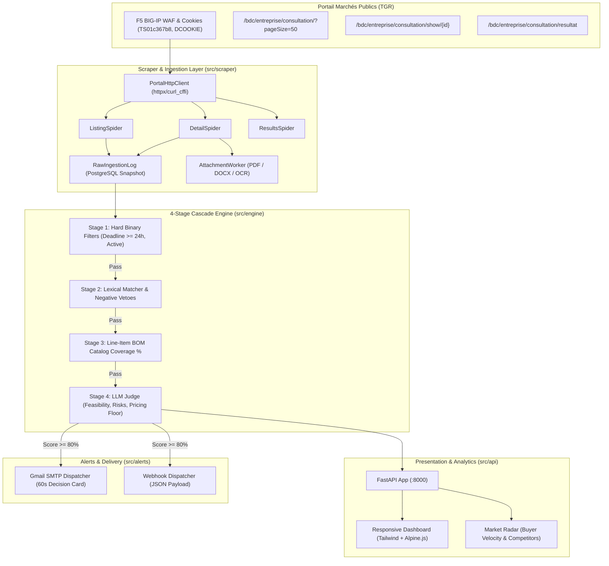

# System Architecture & Pipeline Flow

> **Scope:** High-level topology, end-to-end data lifecycle, and operational sequence.  
> **Source Files:** [`src/scraper/ingestion_service.py`](file:///c:/Users/7mza/mp/src/scraper/ingestion_service.py), [`src/engine/batch_manager.py`](file:///c:/Users/7mza/mp/src/engine/batch_manager.py), [`src/scheduler/jobs.py`](file:///c:/Users/7mza/mp/src/scheduler/jobs.py)

---

## 1. End-to-End Ingestion & Decision Flow

---

## 2. Ingestion Pipeline Stages

1. **Discovery (`ListingSpider`):**
   - Queries `?pageSize=50` to fetch ~1,600 active notices across Morocco in ~32 requests.
   - Extracts: Portal ID, Reference, Buyer Name, Title, Category, Execution City, Publication & Deadline dates.
2. **Snapshot Persistence (`RawIngestionLog`):**
   - Persists raw HTML snapshots into PostgreSQL before parsing. If parser changes or DOM drifts, zero data is lost.
3. **Detail & Line-Item Extraction (`DetailSpider`):**
   - Parses Bootstrap 5 `.accordion-item` cards on `/show/{id}`.
   - Extracts: Article order, designation, unit, quantity, technical specifications.
4. **Attachment Extraction (`AttachmentWorker`):**
   - Downloads consultation ZIP archives.
   - Executes dual-pass text extraction (native `pdfplumber` -> scanned detection -> `tesseract` fallback with `fra` + `ara`).
5. **Cascade Scoring (`ScoringCascadeEngine`):**
   - Evaluates tender against declarative YAML profiles (`software_data.yaml`, `cctv_security.yaml`).
   - Yields an overall score (0–100%) and recommendation (`GO`, `CONSIDER`, `NO-GO`).
6. **Alert Dispatch (`EmailDispatcher` / `WebhookDispatcher`):**
   - Opportunities with score $\ge 80\%$ trigger immediate alerts within 120 seconds of publication.
